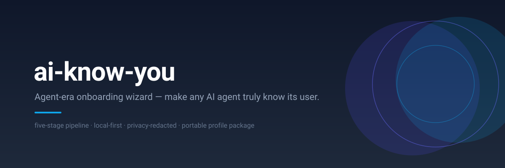
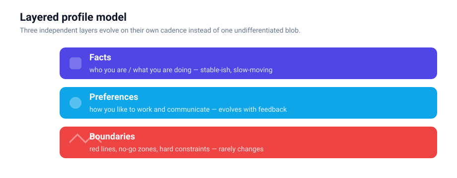
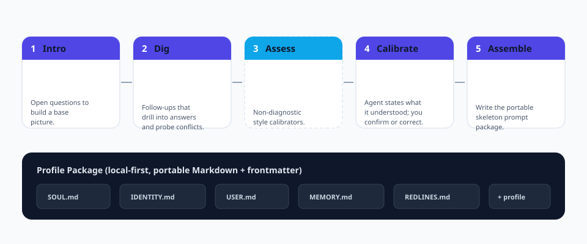
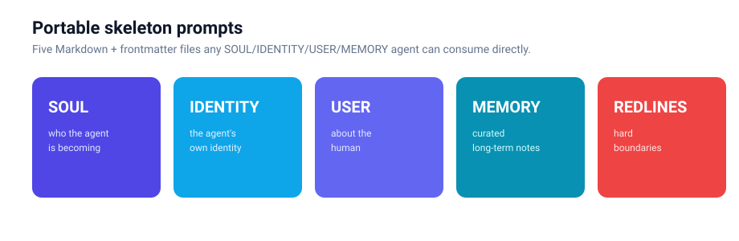
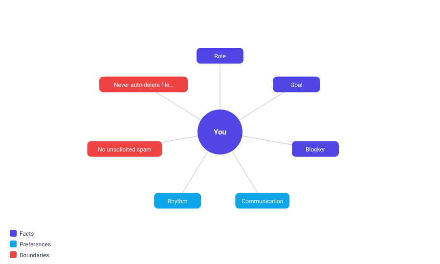

<p align="center">
  
</p>

<p align="center">
  <b>エージェント時代のオンボーディング・ウィザード。</b><br/>
  <b>どの</b> AI エージェントにも、ユーザーを真に理解させる標準化された再実行可能で移植性の高いパイプライン。
</p>

<p align="center">
  <a href="https://github.com/cuiyaohan/ai-know-you/actions"></a>
  
  
  
  
  
</p>

<p align="center">
  <a href="README.md">English</a> ·
  <a href="README.zh-CN.md">简体中文</a> ·
  <a href="README.zh-TW.md">繁體中文</a> ·
  <a href="README.ko.md">한국어</a>
</p>

---

## 概要

`ai-know-you` は、どのエージェントもゼロから「ユーザーを真に理解」できるようにするオープンソースのオンボーディング・ウィザードです——一度の対話で、移植可能なユーザー・プロフィールとエージェント用のスケルトン・プロンプトを生成します。

[MIT ライセンス](LICENSE) で公開されています。完全な日英の説明とライセンス宣言は [DESCRIPTION.md](DESCRIPTION.md) を参照してください。

## なぜ作られたのか

真新しいエージェント——Claude Code、Codex、WorkBuddy、あるいは自作のもの——を渡されても、それはあなたのことを**何も知りません**。曖昧なチャットを重ねながらゆっくり学び、次のセッションでは忘れてしまいます。

`ai-know-you` は「あなたを知る」を**一度で再現可能かつ移植可能な**フローにします。一度実行すれば、構造化された frontmatter を持つプレーンな Markdown ファイルからなる*プロフィールパッケージ*が得られ、どのエージェントでも読み込め、完全にあなたのものになります。

> 一言でいえば：**`ai-know-you` はエージェント・オンボーディングにおける `create-react-app` です。**

## 機能

- **5 段階パイプライン。** 初識 → 深挖 → 任意評価 → **校準** → 裝配。差別化の要は校準段階：エージェントはまず「私が理解したあなた」を提示し、あなたがうなづくか修正してから保存します——「わかったつもり」の幻覚を防ぎます。
- **階層プロフィール・モデル。** 事実 / 好み / 境界がそれぞれ独立して進化し、一塊の泥にならずに済みます。
- **移植可能なスケルトン・プロンプト。** `SOUL` / `IDENTITY` / `USER` / `MEMORY` / `REDLINES` を生成——メモリ・スケルトンを支援するどのエージェントにもそのまま投入可能。
- **多形式エクスポート。** 1 つのプロフィールから `json`、`yaml`、Obsidian 形式 Markdown、Graphviz `dot` を出力。
- **関係図。** プロフィールを自己完結な SVG（または DOT）として描画し、事実・好み・境界のつながりを*可視化*します。
- **ゼロ知識ローカル・ヴォルト。** プロフィール全体を AES-256-CBC + PBKDF2-HMAC-SHA256 で単一の `.akyv` ファイルに封印（任意の `crypto` 依存）。データは端末を出ません。
- **監査可能なスキル推薦器。** プロフィールから「ワンクリック・スキル導入」プロンプトを導出。ルールは透明で説明可能——各推薦に理由が付きます。
- **ローカル優先とプライバシー秘匿化。** 機密カテゴリ（資格情報、身分証、健康、正確な位置）は書き込み前に検出・秘匿化されます。
- **再訪メカニズム。** 再実行で差分更新。パイプラインは冪等かつマージを意識しています。

<p align="center">
  
</p>

## しくみ

<p align="center">
  
</p>

1. **初識（Intro）** —— 冷たいフォームではなく、いくつかの反問でアイデンティティを播種します。
2. **深挖（Dig）** —— 目標・障害・働き方を深掘り。矛盾はその場で顕在化させ解決します。
3. **测评（Assess）**（任意） —— 短いキャリブレーション質問で認知スタイルの信号を折り込みます（決してラベル化しません）。
4. **校準（Calibrate）** —— エージェントが*あなたへの理解*を出力し、あなたが検討します。うなずくか、修正するか。その時だけ保存します。
5. **裝配（Assemble）** —— 5 つのスケルトン・ファイルを描画し、`SKILLS.md` を書き出し、再訪チェックポイントを打ちます。

<p align="center">
  
</p>

## クイックスタート

```bash
pip install ai-know-you            # コア
pip install "ai-know-you[crypto]"  # + 暗号化ヴォルト
```

```bash
ai-know-you run       # 対話型 5 段階ウィザード
ai-know-you sample    # 非対話型デモ（CI / ドキュメント向け）
ai-know-you show      # 保存済みプロフィールを表示
ai-know-you doctor    # 環境自己診断
```

## ワンクリック・スキル導入

裝配が終わると `SKILLS.md` ができます——その中にコピー可能なプロンプトがあります。それをスキルを支援するエージェント（WorkBuddy / Claude / Codex / …）に貼り付けるだけで、推薦スキル群が導入されます：

```
請幫我安裝以下技能（如尚未安裝）：
- coding-copilot
- blunt-communicator
- goal-tracker
- content-writer
- privacy-guard

這些是 ai-know-you 基於我的用戶檔案推薦的技能，請直接啟用。
```

いつでも印刷できます：

```bash
ai-know-you skills
```

## コマンド

| コマンド | 用途 |
| --- | --- |
| `ai-know-you run` | 対話型 5 段階オンボーディング・ウィザード |
| `ai-know-you sample` | 非対話型デモ実行（CI / ドキュメント向け） |
| `ai-know-you show` | 保存済みプロフィールを表示 |
| `ai-know-you export` | `json` / `yaml` / `obsidian` / `dot` へエクスポート |
| `ai-know-you graph` | プロフィール関係図を描画（SVG） |
| `ai-know-you skills` | ワンクリック・スキル導入プロンプトを印刷 |
| `ai-know-you seal` / `unseal` | ローカル `.akyv` ヴォルトの暗号化 / 復号 |
| `ai-know-you doctor` | 環境自己診断 |

## 関係図

<p align="center">
  
</p>

```bash
ai-know-you graph --dir ./my-profile
```

## プライバシーとローカル優先

すべてのデータはローカルのプレーンな Markdown + YAML frontmatter として保存されます——エージェント間で移植可能、人間にも読めます。クラウドもテレメトリもなし。パイプラインは機密フィールドを保存層に書き込む前に剥ぎ取ります（資格情報、身分証番号、健康データ、正確な位置）。

## ロードマップ

- [ ] ライブ・プロフィール + 関係図の Web プレビュー
- [ ] ドメイン別評価のプラグイン・システム
- [ ] 端末間の暗号化同期（依然としてゼロ知識）
- [ ] 主要エージェント記憶フォーマット向けテンプレート群
- [ ] ランディング・ページの `asciinema` / GIF デモ

## 多言語

この README は以下の言語で提供されています：

- [English](README.md) · [简体中文](README.zh-CN.md) · [繁體中文](README.zh-TW.md) · [日本語](README.ja.md) · [한국어](README.ko.md)

## コントリビュート

設計契約は [CONTRIBUTING.md](docs/CONTRIBUTING.md) と [SPEC.md](docs/SPEC.md) を参照してください。ロードマップは [ROADMAP.md](docs/ROADMAP.md) にあります。

## ライセンス

[MIT](LICENSE) © cuiyaohan。本ソフトウェアは「現状有姿」で提供され、いかなる保証もありません。
