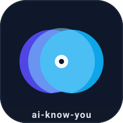
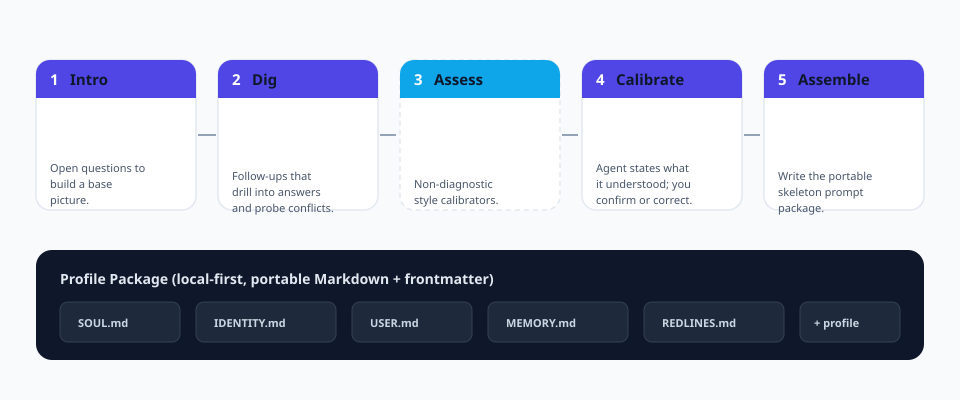

<p align="center">
  
</p>

<h1 align="center">ai-know-you</h1>

<p align="center">
  <b>에이전트 시대의 온보딩 위저드.</b><br/>
  <b>어떤</b> AI 에이전트든 사용자를 진짜로 알게 만드는 표준화되고 재실행 가능하며 이식성 높은 파이프라인.
</p>

<p align="center">
  <a href="https://github.com/cuiyaohan/ai-know-you/actions"></a>
  
  
  
  
</p>

<p align="center">
  <a href="README.md">English</a> ·
  <a href="README.zh-CN.md">简体中文</a> ·
  <a href="README.zh-TW.md">繁體中文</a> ·
  <a href="README.ja.md">日本語</a>
</p>

---

## 왜 만들었는가

새로운 에이전트——Claude Code, Codex, WorkBuddy, 또는 직접 만든 것——를 받으면 그것은 당신에 대해 **전혀 모릅니다**. 모호한 채팅을 거듭하며 천천히 배우고, 다음 세션에는 잊어버립니다.

`ai-know-you` 는 "당신을 아는 것"을 **한 번에, 반복 가능하고 이식 가능한** 흐름으로 만듭니다. 한 번 실행하면 구조화된 frontmatter 를 가진 순수 Markdown 파일로 된 *프로필 패키지*가 생성되어, 어떤 에이전트든 불러올 수 있고 전적으로 당신의 것이 됩니다.

> 한 줄 정의: **`ai-know-you` 는 에이전트 온보딩의 `create-react-app` 입니다.**

## 얻게 되는 것

파이프라인을 실행하면 로컬에 이식 가능한 패키지가 생성됩니다：

| 파일 | 용도 |
|------|------|
| `SOUL.md` | 에이전트가 누구인지——그 목소리와 원칙 |
| `IDENTITY.md` | 에이전트의 자아 정체성 (편집용) |
| `USER.md` | *당신*에 관한 살아있는 프로필 |
| `MEMORY.md` | 정제된 장기 메모 (사실 + 선호) |
| `REDLINES.md` | 절대 넘지 말아야 할 단호한 경계 |
| `profile.md` | 기계가 읽을 수 있는 frontmatter 를 포함한 전체 계층 프로필 |

모든 파일은 사람이 읽을 수 있고 Git 에 친화적이며 특정 에이전트에 종속되지 않습니다.

## 다섯 단계

<p align="center">
  
</p>

1. **첫만남 (Intro)**——기초상을 만드는 열린 질문 (누구인지, 목표, 에이전트 활용 방식).
2. **파고들기 (Dig)**——답변을 깊이 파고들어, 추측하지 않고 모순을 드러낸다.
3. **진단 (Assess)** (선택)——비진단적 커뮤니케이션 스타일 보정. 라벨도 진단도 아님.
4. **보정 (Calibrate)**——에이전트가 당신을 *어떻게 이해했는지* 서술하고, 저장하기 **전**에 확인하거나 수정한다. "환각으로 '당신을 안다'"를 방지.
5. **조립 (Assemble)**——5 개의 스켈레톤 파일과 구조화된 `profile.md` 를 쓴다.

## 설계 원칙

- **로컬 우선.** 모든 것은 당신 디스크에. 클라우드도 텔레메트리도 계정도 없음.
- **기본 켜짐 프라이버시.** 민감 범주(자격 증명, 신분증, 건강, 정밀 위치)는 쓰기 전에 감지·비식별화됨.
- **덩어리가 아닌 계층.** 사실·선호·경계가 독립적으로 진화해 프로필이 일관되게 유지됨.
- **끝이 아닌 살아있는 것.** 재방문 메커니즘이 N 일마다 또는 새 신호 감지 시 증분 업데이트함.
- **이식성.** 표준 Markdown + YAML frontmatter. `SOUL/IDENTITY/USER/MEMORY` 스켈레톤을 지원하는 어떤 에이전트에도 그대로 투입 가능.

## 빠른 시작

```bash
# 설치
pip install -e .

# 대화형 위저드 실행
ai-know-you run

# 비대화형 데모 프로필 생성 (CI / 문서에 적합)
ai-know-you sample --dir ./demo-profile

# 캡처된 내용 확인
ai-know-you show

# 환경 검증
ai-know-you doctor
```

> 심도 모드: `--depth fast` (약 5 분, 충분) 또는 `--depth deep` (약 30 분, 더 좋음). 같은 엔진, 다른 심도. 3 단계 진단은 `--assess` 로 선택.

## 출력 예시

실행 후 `USER.md` 는 다음과 같습니다：

```markdown
# USER.md - About Your Human

- **Name:** Cui
- **Occupation:** indie developer / content creator
- **City:** Shenzhen

## Context
- **primary_goal**: ship ai-know-you to 100k GitHub stars
- **agent_use_case**: coding

## How they like to work
- **communication_style**: direct and concise
- **avoids**: assistants that reply too verbosely
```

## 로드맵

- [ ] 3 단계 진단을 위한 플러그인 시스템 (MBTI, Big Five, 의사결정 스타일)
- [ ] 조립 후 일치하는 스킬 자동 설치
- [ ] 주요 에이전트 기억 형식(Claude, Codex, WorkBuddy) 가져오기/내보내기
- [ ] 정기 재방문 데몬
- [ ] 위저드용 Web UI
- [ ] 이 README 에 더 많은 언어 추가

## 국제화

이 README 는 여러 언어로 제공되며 번역은 커뮤니티가 유지합니다——PR 을 환영합니다.

| 언어 | 파일 |
|------|------|
| English | [README.md](README.md) |
| 简体中文 | [README.zh-CN.md](README.zh-CN.md) |
| 繁體中文 | [README.zh-TW.md](README.zh-TW.md) |
| 日本語 | [README.ja.md](README.ja.md) |
| 한국어 | [README.ko.md](README.ko.md) |

## 기여

번역, 새로운 진단 플러그인, 버그 수정——어떤 도움이든 환영합니다. [CONTRIBUTING.md](docs/CONTRIBUTING.md) 와 [Spec](docs/SPEC.md) 을 참고하세요. 서로 예의를 지켜주세요.

## 라이선스

[MIT](LICENSE) © ai-know-you contributors.
