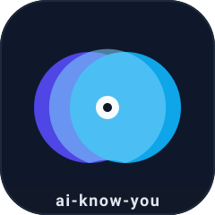
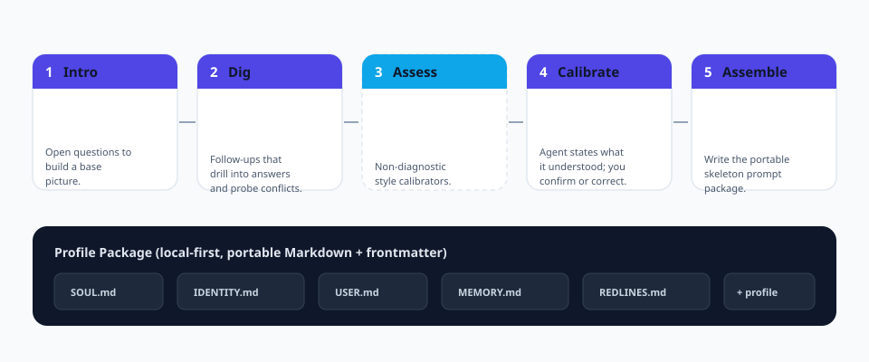

<p align="center">
  
</p>

<h1 align="center">ai-know-you</h1>

<p align="center">
  <b>Agent-era onboarding wizard.</b><br/>
  A standardized, re-runnable, portable pipeline that makes <i>any</i> AI agent truly know its user.
</p>

<p align="center">
  <a href="https://github.com/cuiyaohan/ai-know-you/actions"></a>
  
  
  
  
  
</p>

<p align="center">
  <a href="README.zh-CN.md">简体中文</a> ·
  <a href="README.zh-TW.md">繁體中文</a> ·
  <a href="README.ja.md">日本語</a> ·
  <a href="README.ko.md">한국어</a>
</p>

---

## Description / 描述

> **EN** — An open-source onboarding wizard that makes any Agent "fully understand you" from scratch — one conversation to a portable user profile and Agent skeleton prompts.
>
> **中文** — 让 Agent 从零开始「全方面懂你」的开源初始化向导 —— 一次对话，生成可移植的用户档案与 Agent 骨架提示词。
>
> Licensed under the [MIT License](LICENSE). See [DESCRIPTION.md](DESCRIPTION.md) for the full bilingual description and license declaration.

## Why this exists

When you hand a fresh agent — Claude Code, Codex, WorkBuddy, or your own — it
knows **nothing** about you. It learns you the slow way: one ambiguous chat at a
time, and it forgets by next session.

`ai-know-you` turns "getting to know you" into a **single, repeatable, portable
flow**. Run it once and you get a *profile package* — plain Markdown files with
structured frontmatter — that any agent can load and that you fully own.

> The mental model: **`ai-know-you` is the `create-react-app` of agent onboarding.**

## What you get

Running the pipeline produces a portable package, stored locally:

| File | Purpose |
|------|---------|
| `SOUL.md` | Who the agent is — its voice and principles |
| `IDENTITY.md` | The agent's self-identity, for you to edit |
| `USER.md` | A living dossier about *you* |
| `MEMORY.md` | Curated long-term notes (facts + preferences) |
| `REDLINES.md` | Your hard boundaries, never to be crossed |
| `profile.md` | The full layered profile with machine-readable frontmatter |

All files are human-readable, git-friendly, and agent-agnostic.

## The five stages

<p align="center">
  
</p>

1. **Intro** — open questions to build a base picture (who you are, your goal, how you'll use the agent).
2. **Dig** — follow-ups that drill into your answers and surface contradictions instead of silently guessing.
3. **Assess** *(optional)* — non-diagnostic, communication-style calibrators. Never a label, never a diagnosis.
4. **Calibrate** — the agent states what it *understood* about you. You confirm or correct **before** anything is saved. No hallucinated "I know you."
5. **Assemble** — writes the five skeleton files plus the structured `profile.md`.

## Design principles

- **Local-first.** Everything lives on your disk. No cloud, no telemetry, no account.
- **Privacy by default.** Sensitive categories (credentials, ID documents, health, precise location) are detected and redacted before they are ever written.
- **Layered, not a blob.** Facts, preferences, and boundaries evolve independently so the profile stays coherent over time.
- **Alive, not one-shot.** A revisit mechanism re-checks in every N days or when a new signal appears — incremental updates, not a static form.
- **Portable.** Standard Markdown + YAML frontmatter. Drop it into any agent that supports a `SOUL/IDENTITY/USER/MEMORY` skeleton.

## Quick start

```bash
# install
pip install -e .

# run the interactive wizard
ai-know-you run

# or generate a non-interactive demo profile (great for CI / docs)
ai-know-you sample --dir ./demo-profile

# inspect what was captured
ai-know-you show

# verify the environment
ai-know-you doctor
```

> Depth modes: `--depth fast` (~5 min, good enough) or `--depth deep`
> (~30 min, better). Same engine, different depth. Stage 3 assessment is
> opt-in via `--assess`.

## Example output

After a run, your `USER.md` looks like this:

```markdown
# USER.md - About Your Human

- **Name:** Cui
- **Occupation:** indie developer / content creator
- **City:** Shenzhen

## Context
- **primary_goal**: ship ai-know-you to 100k GitHub stars
- **agent_use_case**: coding

## How they like to work
- **communication_style**: direct and concise
- **avoids**: assistants that reply too verbosely
```

## Roadmap

- [ ] Plugin system for stage 3 assessments (MBTI, Big Five, decision styles)
- [ ] Auto-install matched skills after assembly
- [ ] Import/export to major agent memory formats (Claude, Codex, WorkBuddy)
- [ ] Scheduled revisit daemon
- [ ] Web UI for the wizard
- [ ] More languages in this README (see below)

## Internationalization

This README is available in multiple languages. Translations are community-maintained — PRs welcome.

| Language | File |
|----------|------|
| English | [README.md](README.md) |
| 简体中文 | [README.zh-CN.md](README.zh-CN.md) |
| 繁體中文 | [README.zh-TW.md](README.zh-TW.md) |
| 日本語 | [README.ja.md](README.ja.md) |
| 한국어 | [README.ko.md](README.ko.md) |

## Contributing

We would love your help — whether it is a translation, a new assessment plugin,
or a bug fix. See [CONTRIBUTING.md](docs/CONTRIBUTING.md) and the
[Spec](docs/SPEC.md). Please be excellent to each other.

## License

[MIT](LICENSE) © ai-know-you contributors.
