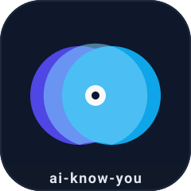
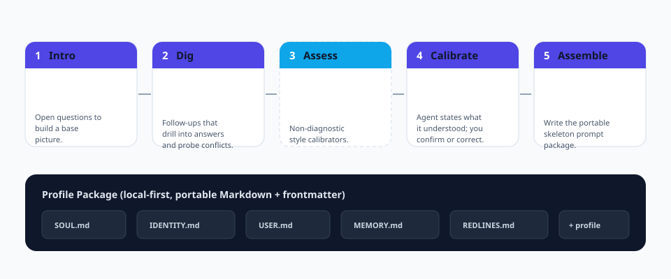

<p align="center">
  
</p>

<h1 align="center">ai-know-you</h1>

<p align="center">
  <b>智能体时代的入职向导。</b><br/>
  一套标准化、可复跑、可移植的流程，让<b>任何</b> AI 智能体真正懂它的用户。
</p>

<p align="center">
  <a href="https://github.com/cuiyaohan/ai-know-you/actions"></a>
  
  
  
  
</p>

<p align="center">
  <a href="README.md">English</a> ·
  <a href="README.zh-TW.md">繁體中文</a> ·
  <a href="README.ja.md">日本語</a> ·
  <a href="README.ko.md">한국어</a>
</p>

---

## 为什么做这个

当你拿到一个全新的智能体——Claude Code、Codex、WorkBuddy，或你自己搭的——它对你**一无所知**。它只能用一次一次含糊的聊天慢慢了解你，而且下个会话就忘了。

`ai-know-you` 把"了解你"做成**一次、可重复、可移植**的流程。跑一遍，你就会得到一个*用户档案包*——带结构化 frontmatter 的纯 Markdown 文件——任何智能体都能加载，且完全归你所有。

> 一句话心智模型：**`ai-know-you` 是智能体入职界的 `create-react-app`。**

## 你会得到什么

跑完流程，会在本地生成一个可移植的档案包：

| 文件 | 作用 |
|------|------|
| `SOUL.md` | 智能体是谁——它的语气与原则 |
| `IDENTITY.md` | 智能体的自我身份，供你编辑 |
| `USER.md` | 关于*你*的鲜活档案 |
| `MEMORY.md` | 提炼后的长期记忆（事实 + 偏好） |
| `REDLINES.md` | 你的硬性边界，绝不可逾越 |
| `profile.md` | 完整分层档案，含机器可读的 frontmatter |

所有文件都人类可读、对 Git 友好、与具体智能体无关。

## 五个阶段

<p align="center">
  
</p>

1. **初识**——开放式问题，建立基础画像（你是谁、目标是什么、打算怎么用智能体）。
2. **深挖**——向下追问你的回答，主动暴露矛盾，而不是默默猜。
3. **测评**（可选）——非诊断性的沟通风格校准。绝不是贴标签，也不是诊断。
4. **校准**——智能体陈述它*理解*的你。在你确认或纠正**之后**才落库。杜绝"我幻觉出我很懂你"。
5. **装配**——写出五份骨架文件，外加结构化的 `profile.md`。

## 设计原则

- **本地优先。** 一切都在你的磁盘上。无云端、无遥测、无账号。
- **隐私默认开启。** 敏感类别（凭据、证件、健康、精确位置）会在写入前被识别并脱敏。
- **分层，而非一锅粥。** 事实、偏好、边界各自独立演进，档案长期保持清晰。
- **是活的，不是一次性的。** 复访机制每 N 天或检测到新信号时回来增量更新，而不是一张静态问卷。
- **可移植。** 标准 Markdown + YAML frontmatter。直接丢进任何支持 `SOUL/IDENTITY/USER/MEMORY` 骨架的智能体。

## 快速开始

```bash
# 安装
pip install -e .

# 运行交互式向导
ai-know-you run

# 或生成一份非交互的示例档案（适合 CI / 文档）
ai-know-you sample --dir ./demo-profile

# 查看已捕获的内容
ai-know-you show

# 自检环境
ai-know-you doctor
```

> 深度模式：`--depth fast`（约 5 分钟，够用）或 `--depth deep`（约 30 分钟，更好）。同一套引擎，不同深度。第 3 阶段测评通过 `--assess` 选开。

## 示例输出

运行后，你的 `USER.md` 大概长这样：

```markdown
# USER.md - About Your Human

- **Name:** Cui
- **Occupation:** indie developer / content creator
- **City:** Shenzhen

## Context
- **primary_goal**: ship ai-know-you to 100k GitHub stars
- **agent_use_case**: coding

## How they like to work
- **communication_style**: direct and concise
- **avoids**: assistants that reply too verbosely
```

## 路线图

- [ ] 第 3 阶段测评的插件系统（MBTI、大五人格、决策风格）
- [ ] 装配后自动安装匹配技能
- [ ] 导入/导出到主流智能体记忆格式（Claude、Codex、WorkBuddy）
- [ ] 定时复访守护进程
- [ ] 向导的 Web 界面
- [ ] 本 README 增加更多语言

## 国际化

本 README 提供多语言版本，翻译由社区维护——欢迎提交 PR。

| 语言 | 文件 |
|------|------|
| English | [README.md](README.md) |
| 简体中文 | [README.zh-CN.md](README.zh-CN.md) |
| 繁體中文 | [README.zh-TW.md](README.zh-TW.md) |
| 日本語 | [README.ja.md](README.ja.md) |
| 한국어 | [README.ko.md](README.ko.md) |

## 贡献

我们非常需要你的帮助——无论是一份翻译、一个新的测评插件，还是一个 bug 修复。请参阅 [CONTRIBUTING.md](docs/CONTRIBUTING.md) 与 [Spec](docs/SPEC.md)。请彼此友善。

## 许可证

[MIT](LICENSE) © ai-know-you contributors。
