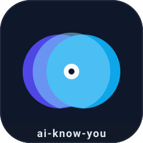
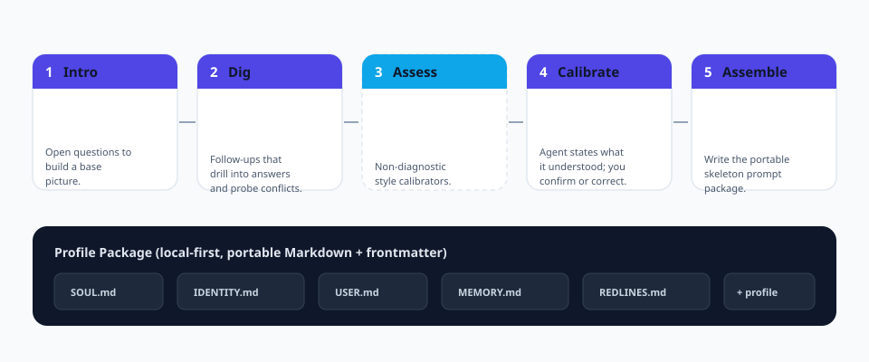

<p align="center">
  
</p>

<h1 align="center">ai-know-you</h1>

<p align="center">
  <b>智慧體時代的入职嚮導。</b><br/>
  一套標準化、可複跑、可移植的流程，讓<b>任何</b> AI 智慧體真正懂它的使用者。
</p>

<p align="center">
  <a href="https://github.com/cuiyaohan/ai-know-you/actions"></a>
  
  
  
  
</p>

<p align="center">
  <a href="README.md">English</a> ·
  <a href="README.zh-CN.md">简体中文</a> ·
  <a href="README.ja.md">日本語</a> ·
  <a href="README.ko.md">한국어</a>
</p>

---

## 為什麼做這個

當你拿到一個全新的智慧體——Claude Code、Codex、WorkBuddy，或你自己搭的——它對你**一無所知**。它只能用一次一次含糊的對話慢慢了解你，而且下個會話就忘了。

`ai-know-you` 把「了解你」做成**一次、可重複、可移植**的流程。跑一遍，你就會得到一個*使用者檔案包*——帶結構化 frontmatter 的純 Markdown 檔案——任何智慧體都能載入，且完全歸你所有。

> 一句話心智模型：**`ai-know-you` 是智慧體入职界的 `create-react-app`。**

## 你會得到什麼

跑完流程，會在本地產生一個可移植的檔案包：

| 檔案 | 作用 |
|------|------|
| `SOUL.md` | 智慧體是誰——它的語氣與原則 |
| `IDENTITY.md` | 智慧體的自我身份，供你編輯 |
| `USER.md` | 關於*你*的鮮活檔案 |
| `MEMORY.md` | 提煉後的長期記憶（事實 + 偏好） |
| `REDLINES.md` | 你的硬性邊界，絕不可逾越 |
| `profile.md` | 完整分層檔案，含機器可讀的 frontmatter |

所有檔案都人類可讀、對 Git 友好、與具體智慧體無關。

## 五個階段

<p align="center">
  
</p>

1. **初識**——開放式問題，建立基礎畫像（你是誰、目標是什麼、打算怎麼用智慧體）。
2. **深挖**——向下追問你的回答，主動暴露矛盾，而不是默默猜。
3. **測評**（可選）——非診斷性的溝通風格校準。絕不是貼標籤，也不是診斷。
4. **校準**——智慧體陳述它*理解*的你。在你確認或糾正**之後**才落庫。杜絕「我幻覺出我很懂你」。
5. **裝配**——寫出五份骨架檔案，外加結構化的 `profile.md`。

## 設計原則

- **本地優先。** 一切都在你的磁碟上。無雲端、無遙測、無帳號。
- **隱私預設開啟。** 敏感類別（憑證、證件、健康、精確位置）會在寫入前被識別並脫敏。
- **分層，而非一鍋粥。** 事實、偏好、邊界各自獨立演進，檔案長期保持清晰。
- **是活的，不是一次性的。** 復訪機制每 N 天或偵測到新訊號時回來增量更新，而不是一張靜態問卷。
- **可移植。** 標準 Markdown + YAML frontmatter。直接丟進任何支援 `SOUL/IDENTITY/USER/MEMORY` 骨架的智慧體。

## 快速開始

```bash
# 安裝
pip install -e .

# 執行互動式嚮導
ai-know-you run

# 或產生一份非互動的範例檔案（適合 CI / 文件）
ai-know-you sample --dir ./demo-profile

# 檢視已擷取的內容
ai-know-you show

# 自我檢查環境
ai-know-you doctor
```

> 深度模式：`--depth fast`（約 5 分鐘，夠用）或 `--depth deep`（約 30 分鐘，更好）。同一套引擎，不同深度。第 3 階段測評透過 `--assess` 選開。

## 範例輸出

執行後，你的 `USER.md` 大概長這樣：

```markdown
# USER.md - About Your Human

- **Name:** Cui
- **Occupation:** indie developer / content creator
- **City:** Shenzhen

## Context
- **primary_goal**: ship ai-know-you to 100k GitHub stars
- **agent_use_case**: coding

## How they like to work
- **communication_style**: direct and concise
- **avoids**: assistants that reply too verbosely
```

## 路線圖

- [ ] 第 3 階段測評的插件系統（MBTI、大五人格、決策風格）
- [ ] 裝配後自動安裝匹配技能
- [ ] 匯入/匯出到主流智慧體記憶格式（Claude、Codex、WorkBuddy）
- [ ] 定時復訪守護程序
- [ ] 嚮導的 Web 介面
- [ ] 本 README 增加更多語言

## 國際化

本 README 提供多語言版本，翻譯由社群維護——歡迎提交 PR。

| 語言 | 檔案 |
|------|------|
| English | [README.md](README.md) |
| 简体中文 | [README.zh-CN.md](README.zh-CN.md) |
| 繁體中文 | [README.zh-TW.md](README.zh-TW.md) |
| 日本語 | [README.ja.md](README.ja.md) |
| 한국어 | [README.ko.md](README.ko.md) |

## 貢獻

我們非常需要你的協助——無論是一份翻譯、一個新的測評插件，還是一個 bug 修復。請參閱 [CONTRIBUTING.md](docs/CONTRIBUTING.md) 與 [Spec](docs/SPEC.md)。請彼此友善。

## 授權

[MIT](LICENSE) © ai-know-you contributors。
